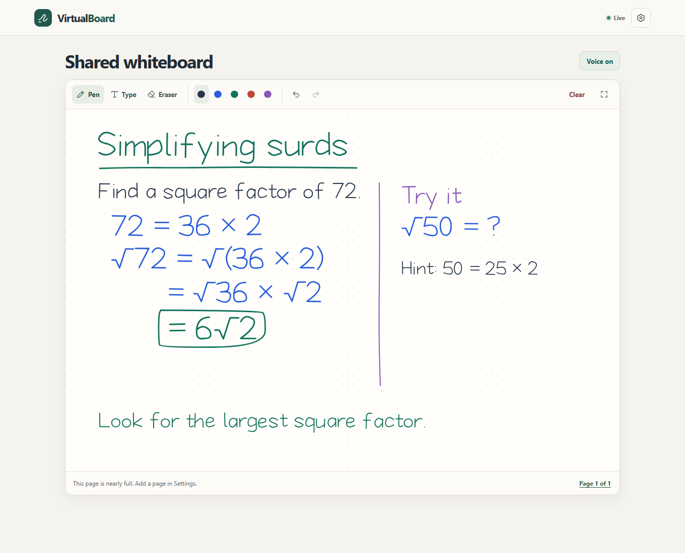

# VirtualBoard

A live, local whiteboard for working through problems with Codex. Watch Codex write letters, equations, and diagrams stroke by stroke, or pick up the pen and add your own work. Codex can read what you typed and inspect your freehand ink as an image.



## Use it in Codex

Install [Node.js](https://nodejs.org/) 22 or newer and have Codex desktop or CLI available. In a checkout of this repository, run:

```sh
npm ci
npm run package:plugin
codex plugin marketplace add .
codex plugin add virtualboard@virtualboard-local
```

Open a fresh **local** Codex chat and try **“Using the whiteboard, explain surds.”** You can ask for Brave explicitly. In desktop, the skill uses the in-app browser when available. If your client has already loaded its plugin list, reload it or restart it to pick up the plugin.

Other things to try:

- “Use the whiteboard to expand `(x + 3)(x − 2)`.”
- Write your own work with **Pen** or **Type**, then ask “Check my last step on the whiteboard.”
- “Make this canvas 1600 by 1000,” or “Continue on a new page.”

The gear opens **Settings**. Add or switch pages, change the canvas size, zoom your view, download the current page as SVG, or try the surds lesson on a blank page. Use the toolbar’s full-screen icon for more room, and **Pan** to move around when zoomed. Each page has its own undo history. Codex lessons continue on a new page when space runs low, while annotations can stay beside the original work.

Open [the same local URL](http://127.0.0.1:4397/) in Brave on the same computer to see ink, page changes, and resizing live in both browsers. View zoom and full screen are local to each browser.

### Voice

Turn **Voice** on in the board for spoken steps synchronized with the ink. The browser uses its available speech voice and shows captions while narrating. **Finish writing** completes the remaining ink and stops the narration.

On eligible accounts, desktop Codex Voice can hand a spoken whiteboard request to a local Codex task. The speech synchronized to the pen comes from VirtualBoard’s browser narration. When you use native Codex Voice and board narration together, each has its own audio controls. [OpenAI’s desktop Voice documentation](https://help.openai.com/en/articles/20001275-chatgpt-work-and-codex)

## Use it without the plugin

```sh
node board.mjs start
node board.mjs open brave
node board.mjs read
node board.mjs apply example.json
node board.mjs export lesson.png
```

Open [the local board](http://127.0.0.1:4397/) after starting it. Run `npm start` to start a foreground server and see its logs. For a local MCP-only setup, register the absolute path to `mcp/index.mjs`:

```sh
codex mcp add virtualboard -- node /absolute/path/to/virtualboard/mcp/index.mjs
```

Install the plugin or register the MCP server directly. Either can use the same board. The checkout also includes the local [Codex skill](.agents/skills/virtualboard/SKILL.md).

The server binds to loopback and saves board pages under `~/.virtualboard/board.json`. Use `VIRTUALBOARD_PORT` and `VIRTUALBOARD_DATA` together for a separate development instance. The plugin runs locally with Node. It needs no provider API key.

## Verify a build

```sh
npm test
npx playwright install chromium
npm run test:browser
npm run package:plugin
```

The tests cover input validation, concurrent writes, recovery after restart, page switching and resizing, stale page protection, MCP reads and PNGs, live pen movement, typing, erasing, undo, export, narration timing, and narrow touch layouts. To run against an installed Brave binary, set `VIRTUALBOARD_TEST_BROWSER` to its full path before running the browser tests.
